# ForeTrade — Enterprise B2B Trade Intelligence & Matchmaking Platform

[](https://fastapi.tiangolo.com)
[](https://nextjs.org)
[](https://python.org)
[](https://www.typescriptlang.org)
[](https://tailwindcss.com)
[](https://pytest.org)
[](LICENSE)

> **ForeTrade** bridges the intelligence gap in international cross-border trade. Moving far beyond static buyer directories and gut-feeling exports, ForeTrade transforms verified customs **Bill of Lading (BoL)** manifests, **UN Comtrade** bilateral flows, **WTO tariff schedules**, and **World Bank risk governance indicators** into an AI-powered, explainable **"Swipe to Export"** matchmaking platform and decision cockpit.

---

## 📑 Table of Contents

- [Executive Overview](#-executive-overview)
- [System Architecture](#-system-architecture)
- [The 5 Real-Time ML Decision Engines](#-the-5-real-time-ml-decision-engines)
- [Value-Added Exporter Tools](#-value-added-exporter-tools)
- [Ingested Open Datasets](#-ingested-open-datasets)
- [Cockpit & Workspace Routes](#-cockpit--workspace-routes)
- [Project Structure](#-project-structure)
- [Getting Started & Local Setup](#-getting-started--local-setup)
- [Testing & Quality Verification](#-testing--quality-verification)
- [Environment Configuration](#-environment-configuration)
- [Production & Docker Deployment](#-production--docker-deployment)

---

## 🌐 Executive Overview

Cross-border trade for emerging market exporters—particularly Indian MSMEs—is burdened by high foreign sales cycle friction, opaque landed costs, compliance hurdles, and commercial default risks.

**ForeTrade solves this with a unified intelligence cockpit:**
1. **Verified Consignee Provenance**: Evaluates real buyers with audited customs Bill of Lading records, historical supplier shares, and container frequencies.
2. **Predictive Corridor Forecasting**: Forecasts bilateral demand 12-24 months out using time-series modeling on official UN Comtrade flows.
3. **Automated Incoterms Landed Costing**: Dynamically computes pricing progression (`EXW` $\rightarrow$ `FOB` $\rightarrow$ `CFR` $\rightarrow$ `CIF` $\rightarrow$ `DDP`) with live ocean freight lanes, marine insurance, and Free Trade Agreement (FTA) preferential tariff savings.
4. **Adaptive Matchmaking ("Swipe to Export")**: Two-tower recommendation model offering high-velocity lead triage with immediate preference learning and explainable compatibility scores.
5. **Cross-Border Risk Simulation**: XGBoost-powered transaction risk classifier evaluating country governance, currency volatility, and payment terms (`Open Account` vs. `Letter of Credit`).

---

## 🏗 System Architecture

```mermaid
flowchart TD
    subgraph DataPipelines["1. Ingestion & Ingest Pipeline"]
        UN["UN Comtrade Flows\n(Bilateral Historical USD & Kg)"]
        BOL["Public Customs Manifests\n(Bill of Lading Consignees & TEU)"]
        WITS["WTO & FTA Tariff Matrix\n(MFN vs Preferential Concessions)"]
        WB["World Bank Governance (WGI)\n(Country Stability & Credit Risk)"]
        RADAR["Trade Bulletins & RSS\n(Tenders & Quota Alerts)"]
    end

    subgraph CoreDB["2. Storage & Auto-Migrating Schema"]
        SQLite[(SQLite / PostgreSQL Engine\nAuto-Column Sync on Lifespan)]
    end

    subgraph MLEngines["3. ML & Intelligence Suite"]
        M1["Model 1: Corridor Forecaster\n(UN Comtrade Time-Series & CAGR)"]
        M2["Model 2: Two-Tower Matchmaker\n(Swipe-to-Export Recommender)"]
        M3["Model 3: Trade Risk Classifier\n(Multi-Class XGBoost Risk Tiers)"]
        M4["Model 4: Demand NLP Radar\n(Tender & Spike Entity Extraction)"]
        M5["Model 5: HS Auto-Classifier\n(Semantic Text-to-HS Embeddings)"]
        M6["Logistics Engine\n(Incoterms 2020 Landed Cost)"]
    end

    subgraph APILayer["4. FastAPI Backend (Python 3.13)"]
        AuthRouter["Auth, RBAC & Workspaces"]
        IntelRouter["Trade Intelligence Endpoints"]
        MatchRouter["Matchmaking & Feedback Loop"]
        LogisticsRouter["Landed Cost & Tariff Calculation"]
    end

    subgraph FrontendApp["5. Next.js 16 Web Cockpit (Turbopack)"]
        Landing["Editorial Landing Page"]
        SwipeUI["Swipe-to-Export Deck"]
        RadarUI["Real-Time Demand Radar"]
        LogisticsUI["Landed Cost & Freight Cockpit"]
        RiskUI["Trade Risk Simulator"]
        CRM["Export CRM & Deal Pipeline"]
    end

    DataPipelines --> CoreDB
    CoreDB --> MLEngines
    MLEngines --> APILayer
    APILayer --> FrontendApp
```



---

## 🧠 The 5 Real-Time ML Decision Engines

### 1. Model 1: Market Opportunity Scorer & Corridor Forecaster
- **Objective**: Predict which international import destinations will expand over the next 12 to 24 months.
- **Methodology**: Time-series predictive modeling on 10+ years of official bilateral trade data.
- **Key Outputs**:
  - 12-month and 24-month forecasted trade values (USD) with **80% and 95% confidence intervals**.
  - **Compound Annual Growth Rate (CAGR)**.
  - **Opportunity Index ($0 - 100$)** incorporating trade velocity and import market concentration (Herfindahl-Hirschman Index).

### 2. Model 2: Two-Tower Matchmaker & Swipe-to-Export Deck
- **Objective**: Match an exporter with optimal overseas buyers based on verifiable operational and commercial fit.
- **Methodology**:
  - **Tower A (Exporter Embeddings)**: Production capacity, certifications (e.g. ISO 9001, OEKO-TEX, CE), minimum order values, historical export destinations.
  - **Tower B (Buyer Embeddings)**: Annual import volume, shipment frequency, required standards, preferred Incoterms, container capacity.
  - **Explainability**: Every card surfaces granular sub-scores:
    $$\text{MatchScore} = 0.35 \cdot \text{CapacityFit} + 0.35 \cdot \text{ComplianceMatch} + 0.30 \cdot \text{CorridorAlignment}$$
- **User Interface**: Smooth, high-velocity Tinder-style card deck with keyboard arrow and click gesture shortcuts.

### 3. Model 3: Cross-Border Trade Risk Simulator
- **Objective**: Prevent export losses, cargo abandonment, and payment defaults before executing shipments.
- **Methodology**: Multi-class **XGBoost Classifier** evaluating:
  - World Bank Governance Indicators (political stability, regulatory quality, rule of law).
  - 30-day foreign exchange currency volatility.
  - Commercial payment terms (`Open Account`, `Letter of Credit (LC)`, `CAD / DP / DA`).
  - Invoice amount relative to the buyer's historical import volume.
- **Outputs**: Calibrated class probabilities (`Low Risk`, `Moderate Risk`, `High Risk`) and prioritized, actionable mitigation strategies (e.g. credit insurance recommendations, milestone LC structures).

### 4. Model 4: Real-Time Demand Radar (NLP Signal Extractor)
- **Objective**: Uncover high-value government procurement tenders, quota openings, and buyer demand spikes before they hit public directories.
- **Methodology**: Regex & NLP entity extraction extracting:
  - Target country, product category, official 6-digit HS code.
  - Estimated budget (USD), submission deadline, and buyer intent score.
- **One-Click Lead Conversion**: Convert any radar signal into an active CRM Company and Lead pipeline item with pre-populated attributes.

### 5. Model 5: Semantic HS Code Auto-Classifier
- **Objective**: Bridge the gap between everyday natural language descriptions and strict 6-digit Harmonized System customs classifications.
- **Methodology**: Semantic text similarity matching over the complete international HS taxonomy.
- **Outputs**: Ranked 6-digit HS codes (e.g., `"6109.10 - T-shirts, singlets and other vests, of cotton, knitted"`) with calibrated confidence percentages.

---

## 🛠 Value-Added Exporter Tools

### Incoterms 2020 Landed Cost & Logistics Engine
Calculates complete shipment economics from factory gate to final destination warehouse:
- **EXW (Ex Works)**: Factory unit cost $\times$ cargo units.
- **FOB (Free on Board)**: Adds inland trucking, origin terminal handling charges (THC), and export clearance.
- **CFR (Cost & Freight)**: Adds ocean container freight rates across major shipping lanes (Nhava Sheva, Mundra, Chennai $\rightarrow$ Los Angeles, Rotterdam, Jebel Ali, Hamburg).
- **CIF (Cost, Insurance & Freight)**: Adds marine cargo insurance ($0.35\%$ with $\$75$ floor).
- **DDP (Delivered Duty Paid)**: Adds destination port handling, customs brokerage, inland delivery, and applied import tariffs.
- **FTA Duty Differential Calculator**: Identifies preferential tariff concessions under bilateral agreements (e.g., India-UAE CEPA, India-Australia ECTA, EU GSP), computing direct tax savings in USD.

---

## 📊 Ingested Open Datasets

All platform intelligence is backed by structured, open data stored in [`data/`](file:///d:/project/FORETRADE%20RB/data):

| Dataset | File Location | Records & Scope |
| :--- | :--- | :--- |
| **UN Comtrade Bilateral Flows** | `data/un_comtrade/raw_comtrade_flows.json` | 10-year bilateral trade history (USD, Kg, unit prices) across US, DE, AE, UK, JP, SA, AU. |
| **Customs Bill of Lading Manifests** | `data/customs_manifests/buyer_manifest_directory.json` | Verified overseas consignees with manifest provenance, TEU volumes, and historical supplier shares. |
| **WTO Tariff Schedules** | `data/tariffs/tariff_schedules.json` | MFN duty rates and preferential FTA rates across active trade corridors. |
| **World Bank Governance Indicators** | `data/country_risk_factors.json` | Political stability, regulatory quality, rule of law, and currency volatility metrics. |
| **WCO Harmonized System Taxonomy** | `data/hs_taxonomy/hs_codes_reference.json` | 6-digit HS taxonomy directory spanning textiles, pharmaceuticals, agro, and engineering goods. |
| **Trained XGBoost Risk Model** | `data/_ml_models/trade_risk_xgb.json` | Pre-trained XGBoost weights for cross-border commercial default classification. |

---

## 🖥 Cockpit & Workspace Routes

The frontend is built on a dark enterprise palette (`#0B0F19`, `#111827`, subtle `border-white/[0.08]`, `Inter` font, tabular figures):

| Route | View Name | Key Capabilities |
| :--- | :--- | :--- |
| `/` | **Landing Page** | Platform overview, verified trade stats, feature highlights, and interactive preview. |
| `/sign-in` & `/register` | **Authentication** | Session cookies, CSRF protection, demo login credentials, and Google OAuth flow. |
| `/workspace/:id` | **Cockpit Dashboard** | Exporter profile summary, trade metrics, recent activity, and workflow navigation. |
| `/workspace/:id/swipe` | **Swipe to Export** | Tinder-style matchmaking deck, two-tower scoring, capacity/certification alignment. |
| `/workspace/:id/radar` | **Demand Radar** | Live procurement bulletins, tenders, intent scores, and one-click lead conversion. |
| `/workspace/:id/logistics` | **Landed Cost Engine** | Incoterms 2020 breakdown (EXW $\rightarrow$ DDP), container freight, FTA tariff savings. |
| `/workspace/:id/risk` | **Trade Risk Simulator** | XGBoost risk tiering, default probability, payment term sensitivity, mitigation advisory. |
| `/workspace/:id/markets` | **Global Corridors** | UN Comtrade bilateral time-series, forecasted growth, unit values, and tariff rates. |
| `/workspace/:id/companies` | **Verified Buyers** | Bill of Lading consignee registry, container frequencies, and supplier track records. |
| `/workspace/:id/leads` | **Deal Desk & CRM** | Multi-stage export pipeline (`new` $\rightarrow$ `contacted` $\rightarrow$ `negotiation` $\rightarrow$ `won`). |
| `/workspace/:id/analytics` | **Analytics** | Export volumes, pipeline value, conversion rates, and buyer activity breakdown. |
| `/workspace/:id/imports/new` | **Data Ingestion** | Upload CSV/Excel customs files with schema mapping and validation previews. |

---

## 📁 Project Structure

```
FORETRADE RB/
├── apps/
│   ├── api/                                # FastAPI Backend Application
│   │   ├── app/
│   │   │   ├── api/                        # HTTP Endpoints & Routers
│   │   │   │   ├── v1/
│   │   │   │   │   ├── auth.py             # Cookie & CSRF session authentication
│   │   │   │   │   ├── matchmaking.py      # Recommendation & Swipe deck API
│   │   │   │   │   ├── trade_intelligence.py # UN Comtrade, ML models, tariffs, risk
│   │   │   │   │   ├── workspaces.py       # Exporter workspace management
│   │   │   │   │   ├── companies.py        # Master company directory
│   │   │   │   │   └── leads.py            # Deal pipeline & CRM stages
│   │   │   │   └── dependencies.py         # Session auth & optional user resolvers
│   │   │   ├── core/                       # App settings, security, request ID
│   │   │   ├── db/                         # SQLAlchemy session & Base engine
│   │   │   ├── models/                     # Database models (Domain, Audit, Trade Intel)
│   │   │   ├── services/
│   │   │   │   ├── data_pipeline/          # Ingestion scripts for UN Comtrade & tariffs
│   │   │   │   └── ml/                     # ML modules (Two-Tower, XGBoost, Radar, etc.)
│   │   │   └── main.py                     # FastAPI factory & startup auto-migration
│   │   ├── tests/                          # 60 Pytest test suites
│   │   └── pyproject.toml                  # Python 3.13 dependencies (uv)
│   │
│   └── web/                                # Next.js 16 Web Application
│       ├── app/                            # App Router routes
│       │   ├── (public)/                   # Public routes (Landing, Sign-In, Register)
│       │   └── (workspace)/                # Authenticated Cockpit & tools
│       ├── components/                     # Workspace sidebar, auth form, UI controls
│       ├── lib/                            # Typed API client with resilient fallbacks
│       ├── tests/                          # Vitest unit & smoke tests
│       ├── package.json                    # Node dependencies
│       └── next.config.ts                  # Reverse proxy rewrites to FastAPI backend
│
├── data/                                   # Real trade datasets & ML models
│   ├── _ml_models/                         # Pre-trained XGBoost weights (JSON)
│   ├── customs_manifests/                  # Verified BoL records
│   ├── hs_taxonomy/                        # WCO 6-digit HS directory
│   ├── tariffs/                            # Bilateral tariff schedules
│   └── un_comtrade/                        # Historical Comtrade flows
│
├── infra/                                  # Docker & deployment infrastructure
│   ├── compose/
│   │   ├── docker-compose.yml              # Multi-container local orchestration
│   │   ├── Dockerfile.api                  # Python API container
│   │   └── Dockerfile.web                  # Next.js web container
│   └── scripts/                            # PowerShell seeding & verification scripts
│
├── .env.example                            # Root environment template
├── .gitignore                              # Git exclusion rules (DBs, logs, caches)
└── README.md                               # Platform documentation
```

---

## 🚀 Getting Started & Local Setup

### Prerequisites
- **Node.js**: `20.x` or higher
- **Python**: `3.13.x` (or `3.12+`)
- **Package Managers**: `npm` and [`uv`](https://docs.astral.sh/uv/) (recommended for fast Python environments)

---

### Step 1: Clone the Repository

```bash
git clone https://github.com/Shravan144/Bandits_LOC8A1.git
cd "FORETRADE RB"
```

---

### Step 2: Backend Setup (`apps/api`)

1. Navigate to the API folder:
   ```bash
   cd apps/api
   ```
2. Copy the environment variables:
   ```bash
   cp .env.example .env
   ```
3. Install dependencies using `uv`:
   ```bash
   uv sync
   ```
4. Run the data ingestion & seed pipeline (initializes database and ML models):
   ```bash
   uv run python -m app.services.data_pipeline.run_pipeline
   ```
5. Start the FastAPI development server:
   ```bash
   uv run uvicorn app.main:app --reload --port 8000
   ```
   *The API will be available at `http://127.0.0.1:8000` (Interactive docs: `http://127.0.0.1:8000/docs`).*

---

### Step 3: Frontend Setup (`apps/web`)

1. Open a new terminal and navigate to `apps/web`:
   ```bash
   cd apps/web
   ```
2. Copy the environment variables:
   ```bash
   cp .env.example .env.local
   ```
3. Install Node dependencies:
   ```bash
   npm install
   ```
4. Start the Next.js development server:
   ```bash
   npm run dev
   ```
   *The web application will be accessible at `http://localhost:3000`.*

---

### Demo Account Credentials

For instant local testing, use the pre-configured demo account:
- **Email**: `demo@example.com`
- **Password**: `DemoPassword123!`
*(Or click **"Fill Demo Account"** directly on the `/sign-in` screen).*

---

## ✅ Testing & Quality Verification

ForeTrade includes automated test coverage across both backend and frontend layers:

### Backend Tests (Pytest)
```bash
cd apps/api
uv run pytest
```
*Executes all 60 tests covering API endpoints, data pipelines, two-tower matchmaking, XGBoost risk evaluation, and landed cost logic.*

### Frontend Tests (Vitest)
```bash
cd apps/web
npm run test
```
*Validates smoke rendering and authentication component logic.*

### Production Build Verification
```bash
cd apps/web
npm run build
```
*Ensures strict TypeScript compliance and Turbopack production compilation across all 17 routes.*

---

## ⚙️ Environment Configuration

### Root `.env.example`
```env
# Database & Backend
DATABASE_URL=sqlite:///./apps/api/foretrade.db
SECRET_KEY=change-this-in-production-to-a-secure-random-secret
ENVIRONMENT=development
ALLOWED_ORIGINS=http://localhost:3000,http://127.0.0.1:3000

# Frontend Next.js
INTERNAL_API_URL=http://127.0.0.1:8000
NEXT_PUBLIC_API_URL=http://localhost:8000

# Optional Google OAuth
GOOGLE_CLIENT_ID=
GOOGLE_CLIENT_SECRET=
GOOGLE_REDIRECT_URI=http://localhost:3000/api/v1/auth/google/callback
```

---

## 🐳 Production & Docker Deployment

To spin up the entire multi-service stack with a single command:

```bash
docker compose -f infra/compose/docker-compose.yml up --build
```

- **Frontend Container**: Port `3000`
- **FastAPI Container**: Port `8000`
- **Database**: Mounted volume with automatic startup schema migration

---

## 📜 License

This project is licensed under the **MIT License**. See `LICENSE` for more information.
